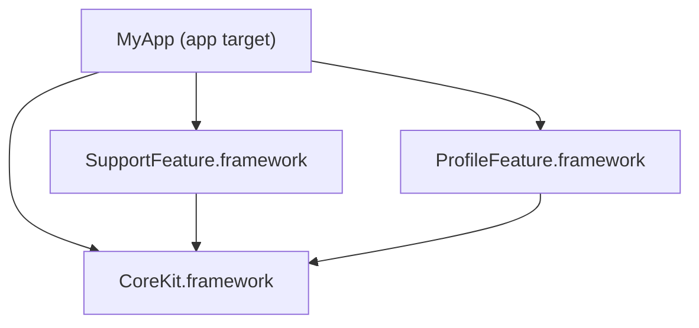
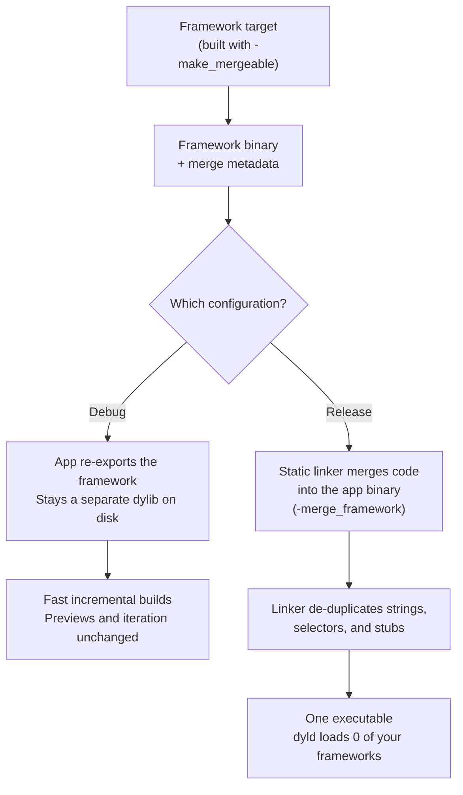

Picture this: your team finally starts modularizing. You pick the easiest feature in the app, the one nobody fights over, and move it into its own framework. You also pull the shared helpers into a `Common` module. No new features. No new code. You just *moved* things.

You archive the release build, check the size, and look again.

The app got **bigger**.

<!-- GIF: confused-math-lady / wait-what -->

Sound familiar?

That happened to me on a team I worked with. We spent a week convinced the build system was haunted. It wasn't. The cause was a keyword every Swift developer types a hundred times a day, and the fix was a build setting most iOS developers have never touched: **mergeable libraries**.

This post walks through the whole thing with a small demo app and real numbers you can reproduce on your own Mac.

---

## Why Modularize at All? (The Pain First)

Every growing iOS codebase reaches the same point:

- **Merge conflicts**: five people editing the same file. Your day is spent resolving conflicts instead of shipping.
- **Build times**: incremental builds keep getting slower, even when you only touched a comment.
- **Ownership**: anyone can change anything, and nobody owns anything.
- **Testing**: you can't test one feature without building the entire app.

Modules fix all of that. Clear boundaries, independent tests, and Xcode can build independent targets **in parallel**. On paper it's all upside.

> *Modularization is like moving into a bigger house. Everyone gets their own room, the fights stop, and nobody mentions the electricity bill until it arrives.*

> **Up next:** the electricity bill.

---

## Expectation vs Reality

Here's the demo app for this post. It's a stand-in for that first round of modularization:



- **`CoreKit`**: the shared module. Analytics event names, models, theme. Every codebase has one, usually named `Common`, `Shared`, or `Utils` and treated as the junk drawer.
- **`SupportFeature`** and **`ProfileFeature`**: two small features that use `CoreKit`.

All three are plain **dynamic frameworks**, which is what Xcode gives you when you click *File → New → Target → Framework*.

Here's what the Release archive contains:

| Binary | Actual code (`__text`) | Size on disk |
|---|---|---|
| `SupportFeature` | **~3 KB** | **73 KB** |
| `ProfileFeature` | ~4 KB | 72 KB |
| `CoreKit` | 88 KB | 316 KB |

Look at the first row again. **3 KB of code ended up as a 73 KB binary.**

That's a fixed tax every dynamic framework pays before it holds a single line of your code. A Mach-O binary is split into segments (`__TEXT`, `__DATA_CONST`, `__DATA`, `__LINKEDIT`), and on arm64 each segment is padded to a **16 KB page**. Four nearly empty segments come to roughly 64 KB of padding, plus load commands and a symbol table. Each extra framework is also another binary that `dyld` has to find, map, and bind every time your app launches.

So splitting one target into four doesn't just move your code. It adds four sets of overhead.

<!-- GIF: this-is-fine-dog -->

> *Your 3 KB feature now ships in 73 KB of packaging. It's the Amazon order where a USB cable arrives in a box big enough for a microwave.*

But padding doesn't explain why **`CoreKit`** is 316 KB when it only has 88 KB of code.

> **Up next:** the real culprit. You've typed it thousands of times and it has never once warned you.

---

## The Culprit Is `public`

When code lives in the app target, everything is `internal` by default. Then you move it into a framework and the compiler starts complaining that it can't find anything. So what does everyone do?

```swift
// Before: inside the app target
struct EventName {
    static let appOpen = "App Open"
}

// After: inside CoreKit, after the compiler yelled at you
public struct EventName {
    public static let appOpen = "App Open"
}
```

You add `public` to everything until the errors go away. I've done it, you've done it, and that's when the size starts to grow.

`public` isn't only about visibility. It changes what the compiler and linker **have to keep** in the binary. It costs you in three places:

1. **`__TEXT` (the code).** For every `public` property, the compiler emits a real getter that other modules can call. It also has to keep anything another module *might* call. The linker can't dead-strip a public symbol, because it has no idea who outside the framework uses it.
2. **`__const` (read-only metadata).** Public types carry type descriptors, field records, and layout information so other modules can work with them. Every public struct and enum adds descriptor data.
3. **`__LINKEDIT` (the phone book).** Every exported symbol needs an entry in the export trie and the symbol table so `dyld` and the linker can find it by name. More `public` means a bigger phone book.

That's the theory. Here's the proof.

### The Experiment

The demo's `CoreKit` contains **360 analytics constants** and **40 model structs**, which is typical for a shared module. I built it twice with the **same code**, once with everything `public` and once with everything `internal`:

```bash
./scripts/public_vs_internal.sh
```

```text
CoreKit (Release, stripped)     public   internal
binary on disk                  316 KB     221 KB
__TEXT,__text (code)             88 KB      71 KB
__const (all segments)           39 KB      33 KB
__LINKEDIT segment              112 KB      48 KB
exported symbols                 3518         36
```

Same logic and features. **30% smaller** binary. The phone book shrank from 112 KB to 48 KB, and exported symbols dropped from **3,518 to 36**.

<!-- GIF: mind-blown / galaxy-brain -->

> *3,518 exported symbols from a module of constants. The phone book is bigger than the town.*

> **Up next:** everything we tried to fix it, and why none of it worked.

---

## Ways of Failure

Once we knew `public` was the problem, we did what any reasonable team would do and tried rearranging the furniture.

**Attempt 1: enum ↔ struct**

```swift
public enum EventName {               // was a struct... then an enum... then a struct
    public static let appOpen = "App Open"
}
```

**Attempt 2: static constants → enum cases**

```swift
public enum EventName: String {
    case appOpen = "App Open"
    case accountTabClicked = "Account Tab Clicked"
}
```

**Attempt 3: nesting everything**

```swift
public enum Constants {
    public enum Event {
        public enum Name {
            public static let appOpen = "App Open"
        }
    }
}
```

**Attempt 4: flattening everything**

```swift
public enum ConstantsEventName {
    public static let appOpen = "App Open"
}
```

None of these made a meaningful difference. The shape of the type barely matters, because the surface is still `public` and the framework is still a separate binary with its own overhead. We were reorganizing a suitcase and expecting it to weigh less.

> *Four refactors, four PRs, four approvals. Net savings: a few bytes and a lot of reviewers' patience.*

The real fix is to make fewer things `public`, and you should. In a large codebase, though, that's a slow cleanup, not a quick win. So we asked a different question:

**What if the frameworks didn't have to stay separate in the build we actually ship?**

> **Up next:** the build setting that does exactly that.

---

## Mergeable Libraries in 60 Seconds

Apple introduced **mergeable libraries** in Xcode 15. They address an old trade-off:

| | Build time | Launch time |
|---|---|---|
| **Dynamic frameworks** | Fast incremental builds | Slower: `dyld` loads every framework |
| **Static libraries** | Slower: big relinks | Fast: one binary |

Mergeable libraries give you both, depending on the build:

- **Debug**: frameworks stay dynamic. The linker **re-exports** them from the app instead of merging, so incremental builds stay fast.
- **Release**: the static linker **merges** the framework code into your app binary. One binary and fewer framework loads at launch.



What happens under the hood:

1. **Building the framework.** The framework is linked with `-make_mergeable`. The linker records extra **metadata** that describes how to merge this library later. Apple notes that this metadata roughly doubles the size of the dylib, which is fine because it never ships.
2. **Building the app (Release).** The linker uses that metadata to merge the framework into the app binary (`-merge_framework`). Because everything ends up in one output, it can **de-duplicate** strings, symbol references, Objective-C selectors, and `objc_msgSend` stubs across modules.
3. **After the merge.** The original framework code and its metadata are no longer needed. The framework *folder* stays in the bundle so resources and `Bundle(for:)` lookups keep working. Its code is gone.
4. **Building the app (Debug).** No merging happens. The app re-exports each framework, which looks like this in the demo's Debug build:

```bash
otool -l MyApp.app/MyApp.debug.dylib | grep -A2 LC_REEXPORT_DYLIB
```

```text
         name @rpath/CoreKit.framework/CoreKit (offset 24)
         name @rpath/ProfileFeature.framework/ProfileFeature (offset 24)
         name @rpath/SupportFeature.framework/SupportFeature (offset 24)
```

Think of it as **dynamic frameworks while you develop and a static binary when you ship**, with you changing nothing in between.

<!-- GIF: shut-up-and-take-my-money -->

> **Up next:** how to turn it on. It's one setting.

---

## Enabling Mergeable Libraries

There are two ways to do it.

### Option 1: Automatic Merging (start here)

1. Select your **app target**.
2. In **Build Settings**, search for **Create Merged Binary** (`MERGED_BINARY_TYPE`).
3. Set it to **Automatic**.

```text
// MyApp target
MERGED_BINARY_TYPE = automatic
```

That's it. Xcode treats every **direct** framework dependency built in your project as mergeable and merges them in Release.

Use it for **small and simple dependency graphs**, where your app links its frameworks directly.

### Option 2: Manual Merging (for complex graphs)

If you need precise control over what gets merged, or your graph has indirect dependencies and external projects:

```text
// The merging target (your app, or an umbrella framework)
MERGED_BINARY_TYPE = manual

// Each framework you want merged
MERGEABLE_LIBRARY = YES
```

### The Cheat Sheet

| Setting | Where | Value | What it does |
|---|---|---|---|
| `MERGED_BINARY_TYPE` | App target | `automatic` | Merges all direct dynamic dependencies in Release |
| `MERGED_BINARY_TYPE` | App / umbrella target | `manual` | Merges only libraries marked mergeable |
| `MERGEABLE_LIBRARY` | Framework target | `YES` | Builds the framework with merge metadata |
| `-Wl,-no_merged_libraries_hook` | App, Other Linker Flags | — | Skips the bundle-lookup hook (only if you don't need `Bundle(for:)` on merged frameworks) |

One gotcha: **the linker only merges direct dependencies.** If `CoreKit` only reaches your app through `SupportFeature`, add it as an explicit dependency of the app target. That's why the demo's `MyApp` links all three frameworks directly.

In the demo repo, all of this is a Tuist environment variable:

```bash
TUIST_MERGE_MODE=automatic tuist generate
```

> *Two build settings. That's the whole migration. It's the least effort I've ever spent on a performance win, and I once fixed a memory leak by deleting a `print`.*

> **Up next:** the receipts.

---

## The Receipts

Same app, same code, two Release archives:

```bash
./scripts/measure.sh
```

| Archived `MyApp.app` | Dynamic frameworks | Mergeable (automatic) |
|---|---|---|
| **`.app` total** | **560 KB** | **436 KB** |
| `MyApp` executable | 73 KB | 305 KB |
| `CoreKit` executable | 316 KB | 33 KB (empty shell) |
| `SupportFeature` executable | 73 KB | 33 KB (empty shell) |
| `ProfileFeature` executable | 72 KB | 33 KB (empty shell) |
| Your frameworks `dyld` loads at launch | 3 | **0** |
| Exported symbols | 3,518 (`CoreKit`) | **1** (`MyApp`) |

What changed:

- **The app is 22% smaller.** All the code, metadata, and symbol tables now live in one binary instead of four, with one set of segment padding and duplicates removed.
- **The app executable grew from 73 KB to 305 KB.** That's expected, because all the code moved in there. The `CoreKit` executable dropped from 316 KB to an **empty 32 KB shell**. `size -m` shows a `__TEXT` segment with `__text: 0`.
- **`dyld` has less to do.** `otool -L MyApp` no longer lists `@rpath/CoreKit.framework`. Your frameworks aren't loaded at launch at all.
- **The phone book is gone.** Nothing outside the app needs those 3,518 symbols anymore, so they're no longer exported.

This demo has three small frameworks. Real apps have dozens, and the per-framework tax adds up with every one.

<!-- GIF: success-kid / nailed-it -->

> **Up next:** the fine print.

---

## With Great Power Comes Great Responsibility

Mergeable libraries aren't free. Here are the trade-offs:

- **Debug and Release differ.** Debug keeps separate re-exported frameworks and Release merges them. A bug that only shows up when code is merged (load order, `+load` side effects, `Bundle(for:)` assumptions) only appears in Release. Test your Release builds.
- **Release builds do more work.** Merging is extra linker work on every archive. In a tiny demo you won't notice. In a huge app, measure it.
- **Configuration needs discipline.** With manual merging, every new module needs `MERGEABLE_LIBRARY = YES`, or it silently stays dynamic. Put it in a shared `.xcconfig` or your project generator so nobody has to remember.
- **Resource lookups need iOS 12+.** `Bundle(for:)` on a merged framework depends on a runtime hook added in iOS 12. Most apps already target iOS 12 or later.
- **`dlopen` and scripts.** Code that `dlopen`s a framework path, and build scripts that expect the framework binary to contain code, will break. Point them at the merged binary.
- **Crash reports change.** Stack frames from merged code show the **app binary** as the image, not the framework. Symbolication still works.

### Use Mergeable Libraries if:

- You have **more than a handful** of first-party dynamic frameworks
- App size or **launch time** is a metric someone reviews
- You want **fast Debug builds** and don't want to switch everything to static libraries

### Stick with what you have if:

- You have **one or two** frameworks and are already mostly static
- You ship **binary SDKs** to other teams (merging is for the final app)
- You rely heavily on `dlopen` or tooling built around framework paths, and can't change it yet

<!-- GIF: worth-it / long-term-investment -->

The sweet spot is a **modular app with many first-party frameworks** that cares about size and launch time. For a single-target app, there's nothing to merge.

---

## Best Practices (Merging Doesn't Excuse a Messy API)

Mergeable libraries hide the cost of modularization in the shipped app. Your API surface still matters:

- **Use `public` only where another module needs it.** Default to `internal`. The 30% drop in the experiment above came from changing access levels alone.
- **Turn on dead code stripping**: `DEAD_CODE_STRIPPING = YES`. It's the default in new projects, but check older ones.
- **Optimize Swift for size** in Release when size matters more than raw speed: `SWIFT_OPTIMIZATION_LEVEL = -Osize`, with whole-module optimization.
- **Don't export symbols from the app.** Apple recommends `-Wl,-no_exported_symbols` in Other Linker Flags. If you have app extensions that need entry points, use an **Exported Symbols File** instead. Run `nm -gU` on your binary to see what it currently exports.

---

## What's Next

You now know why modularization can make an app bigger, how to prove it with `size` and `nm`, and how to win most of it back with two build settings. Where to go next:

- **Measure your own app**: run `size -m` and `nm -gU | wc -l` on your biggest framework. The export count will probably surprise you.
- **Audit `public`**: find types that are `public` only because the compiler complained once.
- **Try automatic merging** on a branch, archive, and compare the `.app` sizes.
- **Watch the WWDC session**: [Meet mergeable libraries (WWDC23)](https://developer.apple.com/videos/play/wwdc2023/10268/) covers the linker internals in depth.

The full demo, with the size scripts, the public vs internal experiment, and the Tuist manifest, is on GitHub:

**[github.com/Hitarthbhatt/mergeable-libraries-demo](https://github.com/Hitarthbhatt/mergeable-libraries-demo)**

The first time I saw an app get bigger after we only *moved* code, I blamed Xcode, then the CI cache, then the cosmos. It took a week of failed refactors to see that the real issue was a keyword I'd typed thousands of times without thinking. Now I check `nm -gU` before I blame anything.

---

*Found this useful? Share it with the iOS developer on your team who just created their fifth framework this sprint. Have questions? Drop them in the comments and I'll help.*
