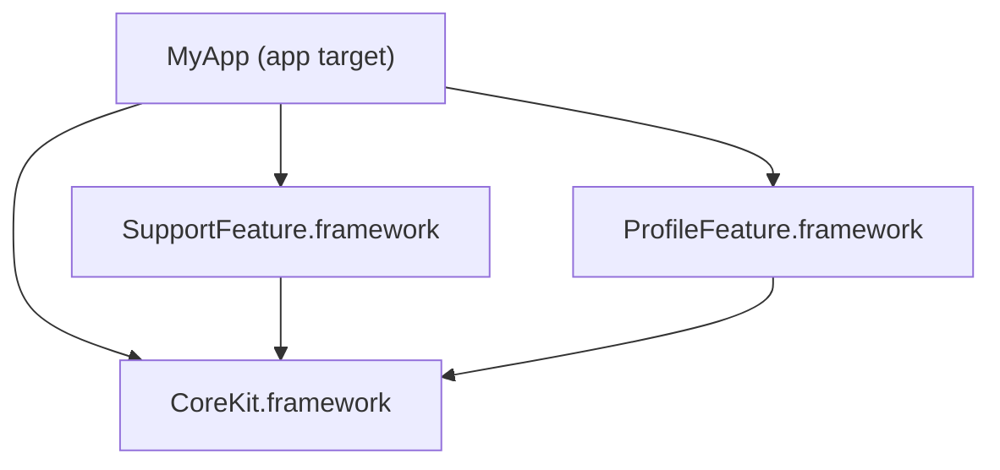
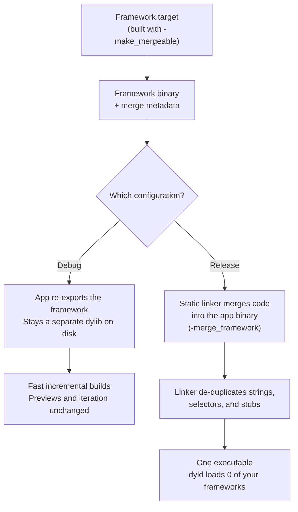

Picture this: your team finally commits to modularization. There's a kickoff meeting. Someone draws boxes and arrows on a whiteboard. The word "scalable" gets said eleven times.

You start small. You take one sleepy feature that nobody fights over, move it into its own framework, and dump the shared helpers into a `Common` module. You write **zero new code**. You only move files from one folder to another.

Then you archive the release build, check the app size, and see that **the app got bigger.**


Sound familiar?

This happened on a team I worked with. For about a week we were sure the build system was haunted. We cleaned DerivedData. We blamed CI. Someone suggested restarting the Mac, which in iOS development counts as a legitimate debugging technique.

The build system wasn't haunted. The culprit was a keyword you've typed thousands of times without thinking. The fix was a build setting most iOS developers have never scrolled down far enough to see.

Let's solve the mystery. I rebuilt the whole crime scene as a small demo app, so every number in this post is one you can reproduce yourself.

---

## We Did Everything Right (That's the Annoying Part)

Modularization wasn't a mistake. It was the right call.

The codebase had reached the stage every growing iOS app reaches. Five people editing the same file meant your morning went to merge conflicts instead of features. Incremental builds kept getting slower even when you only fixed a typo. Nobody owned anything, so everybody changed everything. And testing one feature meant building the entire universe first.

Modules fix all of that. You get clear boundaries, each feature can be tested on its own, and Xcode can build independent targets **in parallel** while you get coffee.

Nobody at the kickoff mentioned that every module comes with a bill.

> **Up next:** the bill. It's itemized, and it's printed in kilobytes.

---

## The Packaging Tax Nobody Mentioned

Here's the demo app, a faithful recreation of that first modularization:



`CoreKit` is the shared module, the junk drawer every codebase has. Analytics event names, models, theme colors, and that one `String` extension nobody remembers writing. `SupportFeature` and `ProfileFeature` are two small features that use it. All three are plain dynamic frameworks, which is exactly what Xcode gives you from *File → New → Target → Framework*.

I archived it in Release and opened the bundle:

| Binary | Actual code inside | Size on disk |
|---|---|---|
| `SupportFeature` | **~3 KB** | **73 KB** |
| `ProfileFeature` | ~4 KB | 72 KB |
| `CoreKit` | 88 KB | 316 KB |

Read the first row again slowly. **Three kilobytes of code shipped as a 73 KB binary.**

It's like ordering a USB cable online and receiving it in a box big enough for a microwave.


Here's where the space goes. A Mach-O binary is split into segments (`__TEXT`, `__DATA_CONST`, `__DATA`, and `__LINKEDIT`), and on arm64 each one is padded to a **16 KB page**. That holds even when a segment contains almost nothing. So every dynamic framework pays roughly 64 KB in padding before it holds a single useful line of code, plus its own load commands and symbol table.

The bill also arrives at runtime. Every framework is another file that `dyld` has to find, open, map into memory, and bind each time your app launches. Think of `dyld` as airport security. One passenger is quick. Forty passengers, each with their own passport and suitcase, is a long line.

That covers the two small frameworks. It doesn't explain why `CoreKit` weighs **316 KB** when it holds only 88 KB of code.

> **Up next:** we pull the mask off the villain. You've worked with them for years.

---

## Unmasking the Villain

Remember the moment you moved code out of the app target and Xcode lit up red? `'EventName' is inaccessible due to 'internal' protection level`, about four hundred times. What did everybody do?

```swift
// Before: living happily in the app target
struct EventName {
    static let appOpen = "App Open"
}

// After: moved into CoreKit, after the compiler yelled at you
public struct EventName {
    public static let appOpen = "App Open"
}
```

You sprinkled `public` on everything until the red went away. I did it, you did it, and the whole team did it with the speed of people who had a sprint deadline.


*And it would've gotten away with it too, if it weren't for `size -m`.*

`public` feels like a visibility switch. To the compiler and linker it's a promise: **"someone outside this framework might use this, so keep it and make it easy to find."** That promise costs you in three places:

**1. The code (`__TEXT`).** For every public property, the compiler emits a real getter that other modules can call. More importantly, the linker can't dead-strip anything public. It has no idea which code outside the framework uses those symbols, so it keeps all of them, just in case.

**2. The metadata (`__const`).** Public types carry their type descriptors, field records, and layout information so other modules can work with them. Every public struct and enum ships with its own paperwork.

**3. The phone book (`__LINKEDIT`).** Every exported symbol gets an entry in the framework's export trie and symbol table, so `dyld` and the linker can look it up by name. Each `public` adds another entry to the phone book.

That's the theory. Courts want evidence.

### The Evidence

The demo's `CoreKit` has **360 analytics constants** and **40 model structs**, a modest amount for a shared module. I built it twice with **identical code**: once with everything `public` and once with everything `internal`.

```bash
./scripts/public_vs_internal.sh
```

```text
CoreKit (Release, stripped)     public   internal
binary on disk                  316 KB     221 KB
__TEXT,__text (code)             88 KB      71 KB
__const (all segments)           39 KB      33 KB
__LINKEDIT segment              112 KB      48 KB
exported symbols                 3518         36
```

Same logic and same features, and the `internal` build is **30% smaller**. The phone book shrank from 112 KB to 48 KB. The framework was exporting **3,518 symbols**, from a module that is mostly string constants.


The phone book was bigger than the town.

> **Up next:** the week we spent trying to fix this by rearranging the furniture.

---

## Rearranging the Furniture

Once we knew `public` was the villain, we did what engineers do with a problem they don't fully understand: we refactored at it.

First we converted the enums into structs, then the structs back into enums, because someone read a blog post.

```swift
public enum EventName {
    public static let appOpen = "App Open"
}
```

Then we swapped the static constants for enum cases.

```swift
public enum EventName: String {
    case appOpen = "App Open"
    case accountTabClicked = "Account Tab Clicked"
}
```

Then we nested everything like Russian dolls.

```swift
public enum Constants {
    public enum Event {
        public enum Name {
            public static let appOpen = "App Open"
        }
    }
}
```

Finally we flattened it all back out.

```swift
public enum ConstantsEventName {
    public static let appOpen = "App Open"
}
```

Four refactors, four PRs, four sets of approvals. We looked at the size report after each one and got the same answer every time.


The shape of the type barely matters. The surface is still `public`, and the framework is still a separate binary paying its own packaging tax. We were repacking a suitcase and hoping it would weigh less at check-in.

The honest fix is to make fewer things `public`, and you should do that. In a large codebase, though, that's a quarter-long cleanup, not a quick win. So we asked a lazier and smarter question:

**What if the frameworks didn't have to stay separate in the build we actually ship?**

> **Up next:** Apple had already built exactly that, and nobody told us.

---

## Why Not Both?

Every iOS developer eventually faces this trade-off:

- **Dynamic frameworks**: fast incremental builds and a slower launch, because `dyld` processes every framework.
- **Static libraries**: a fast launch, and slower builds because of big relinks.

For years you picked one and complained about it. Then Xcode 15 shipped **mergeable libraries** and said:


The idea is simple. In **Debug**, your frameworks stay dynamic, so builds stay fast and your iteration loop doesn't change. In **Release**, the linker merges all that framework code into your app binary, so the app you ship is a single binary that launches like a static one.



Here's what happens behind the curtain.

When Xcode builds a mergeable framework, it links it with `-make_mergeable`. That tells the linker to attach **metadata** describing how to merge this library later. Apple says this metadata roughly doubles the size of the dylib. That sounds alarming until you learn it never reaches your users.

When you archive for Release, the linker uses that metadata to merge every framework into your app (`-merge_framework`). Since everything now sits in one binary, the linker can clean up across modules. It **de-duplicates** strings, symbol references, Objective-C selectors, and `objc_msgSend` stubs. Think of it as Marie Kondo walking through your modules and asking each copy of the same string whether it sparks joy.

Your framework folders stay in the bundle, so resources and `Bundle(for:)` keep working. They're just empty now. In the demo, the merged `CoreKit` binary is a hollow 32 KB shell with `__text: 0`.

In Debug, nothing is merged at all. The app **re-exports** each framework, which you can see in the demo's Debug build:

```bash
otool -l MyApp.app/MyApp.debug.dylib | grep -A2 LC_REEXPORT_DYLIB
```

```text
         name @rpath/CoreKit.framework/CoreKit (offset 24)
         name @rpath/ProfileFeature.framework/ProfileFeature (offset 24)
         name @rpath/SupportFeature.framework/SupportFeature (offset 24)
```

You get dynamic frameworks at your desk and one static binary on your users' phones, with nothing to change in between.

> **Up next:** how to turn it on. Set your expectations low. Lower.

---

## Two Settings. I'm Not Kidding.

### Automatic: the "I have a life" option

Select your **app target**, open **Build Settings**, search for **Create Merged Binary** (`MERGED_BINARY_TYPE`), and set it to **Automatic**.

```text
// MyApp target
MERGED_BINARY_TYPE = automatic
```

That's the whole thing.


Xcode treats every **direct** framework dependency built in your project as mergeable and merges them in Release. This works well for small and simple graphs, where the app links its frameworks directly.

### Manual: the control-freak option

If your graph has indirect dependencies, external projects, or modules you specifically *don't* want merged, use manual mode:

```text
// The target doing the merging (your app, or an umbrella framework)
MERGED_BINARY_TYPE = manual

// Every framework you want merged into it
MERGEABLE_LIBRARY = YES
```

### The cheat sheet

| Setting | Where | What it does |
|---|---|---|
| `MERGED_BINARY_TYPE = automatic` | App target | Merges all direct dynamic dependencies in Release |
| `MERGED_BINARY_TYPE = manual` | App / umbrella target | Merges only libraries marked mergeable |
| `MERGEABLE_LIBRARY = YES` | Framework target | Builds the framework with merge metadata |
| `-Wl,-no_merged_libraries_hook` | App's Other Linker Flags | Skips the bundle-lookup hook. Only use it if merged frameworks have no resources |

There's one trap that will get you: **the linker only merges direct dependencies.** If `CoreKit` only reaches your app through `SupportFeature`, it stays a separate dynamic framework and you'll wonder why nothing changed. Add it as an explicit dependency of the app target. That's why the demo's `MyApp` links all three frameworks directly.

In the demo repo, switching modes is one environment variable:

```bash
TUIST_MERGE_MODE=automatic tuist generate
```

> **Up next:** the receipts. I know you skipped down here anyway.

---

## The Receipts

Same app and same code, archived twice:

```bash
./scripts/measure.sh
```

| Archived `MyApp.app` | Dynamic frameworks | Mergeable (automatic) |
|---|---|---|
| **`.app` total** | **560 KB** | **436 KB** |
| `MyApp` executable | 73 KB | 305 KB |
| `CoreKit` executable | 316 KB | 33 KB (empty shell) |
| `SupportFeature` executable | 73 KB | 33 KB (empty shell) |
| `ProfileFeature` executable | 72 KB | 33 KB (empty shell) |
| Your frameworks `dyld` loads at launch | 3 | **0** |
| Exported symbols | 3,518 (`CoreKit`) | **1** (`MyApp`) |

The app is **22% smaller** after two build settings and zero code changes.

The app executable grew from 73 KB to 305 KB, which is exactly what should happen, because all the code moved in. The frameworks that used to hold it are now hollow shells. `otool -L MyApp` no longer lists any of your frameworks, so `dyld` doesn't load them at launch. The phone book is gone too: nothing outside the app needs those 3,518 symbols anymore, so they aren't exported.

This demo has three small frameworks. Real apps have dozens, each paying its own packaging tax, so picture these numbers at that scale.

> **Up next:** the fine print. There's always fine print.

---

## Uncle Ben Was Right


Mergeable libraries are a real win, but they aren't magic. Here's what to watch for.

**Debug and Release are now different apps.** Debug keeps separate, re-exported frameworks. Release merges everything. Bugs that depend on how code is laid out (load order, `+load` side effects, `Bundle(for:)` assumptions) only appear in Release, so test the build you actually ship.

**Release builds work harder.** Merging is extra linker work on every archive. In this tiny demo it's noise. In a huge app, measure it before your CI team measures it for you.

**Manual mode needs discipline.** Every new module needs `MERGEABLE_LIBRARY = YES`, or it silently stays dynamic and nobody notices for three months. Put the setting in a shared `.xcconfig` or your project generator so nobody has to remember it.

**There are a few edge cases.** `Bundle(for:)` on merged frameworks depends on a runtime hook added in **iOS 12**. If you `dlopen` a framework by path, or run build scripts that expect the framework binary to contain code, point them at the merged binary. Crash reports will show your app binary as the image for merged code. Symbolication still works.

### Use mergeable libraries if:
- You have **more than a handful** of first-party dynamic frameworks
- App size or **launch time** shows up on someone's dashboard
- You want fast Debug builds *and* a lean Release build, without switching everything to static libraries

### Skip them for now if:
- You have one or two frameworks and you're already mostly static
- You ship **binary SDKs** to other teams (merging belongs in the final app)
- Your tooling depends on `dlopen` or framework paths and you can't change it yet

The sweet spot is a **modular app with many first-party frameworks** that cares about size and launch time. A single-target app has nothing to merge, so enjoy your monolith.

---

## Merging Doesn't Excuse a Messy API

Mergeable libraries hide the cost of modularization in the app you ship. They don't make `public` free in your codebase. A few habits keep you honest:

**Default to `internal`** and only make something `public` when another module actually needs it. That 30% drop came from changing access levels alone, before any merging.

**Check that dead-code stripping is on** (`DEAD_CODE_STRIPPING = YES`). It's the default in new projects, but older ones sometimes have surprises.

**Try `-Osize`** (`SWIFT_OPTIMIZATION_LEVEL`) with whole-module optimization for Release, if size matters more to you than the last bit of runtime speed.

**Don't let your app export symbols it doesn't need.** Apple recommends `-Wl,-no_exported_symbols`. If you have app extensions that need entry points, use an **Exported Symbols File** instead. Running `nm -gU` on your binary will tell you exactly how big your phone book is.

---

## Case Closed

You now know why moving code into frameworks can make your app *bigger*, how to catch the culprit with `size` and `nm`, and how to win most of it back with two build settings.

Your homework:

- **Run `nm -gU YourFramework | wc -l`** on your biggest framework. The export count will probably hurt your feelings.
- **Hunt down unnecessary `public`s**, especially the ones that only exist because the compiler complained once in 2021.
- **Turn on automatic merging** on a branch, archive, and compare.
- **Watch [Meet mergeable libraries (WWDC23)](https://developer.apple.com/videos/play/wwdc2023/10268/)** for the full linker deep dive.

The demo, with the size scripts, the public vs internal experiment, and a Tuist manifest that flips between modes, is on GitHub:

**[github.com/Hitarthbhatt/mergeable-libraries-demo](https://github.com/Hitarthbhatt/mergeable-libraries-demo)**

The first time I watched an app grow after we only *moved* code, I blamed Xcode, then the CI cache, then the alignment of the planets. It took a week of failed refactors to see that the villain was a six-letter keyword I'd been typing on autopilot for years. Now I run `nm` before I blame anything.


---

*Found this useful? Send it to the teammate who just created their fifth framework this sprint. Have questions or your own "the app got bigger" story? Drop it in the comments and I'll help.*
